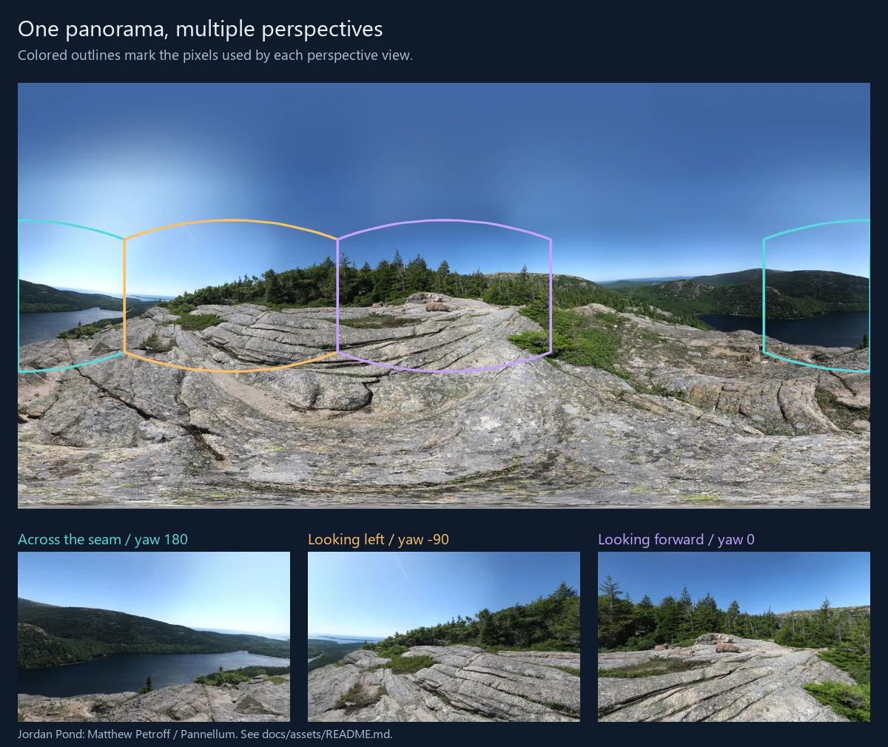
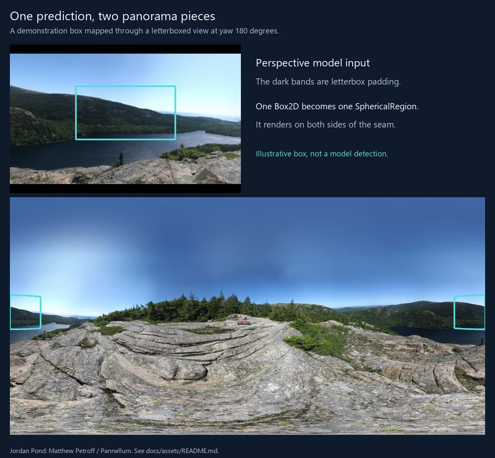
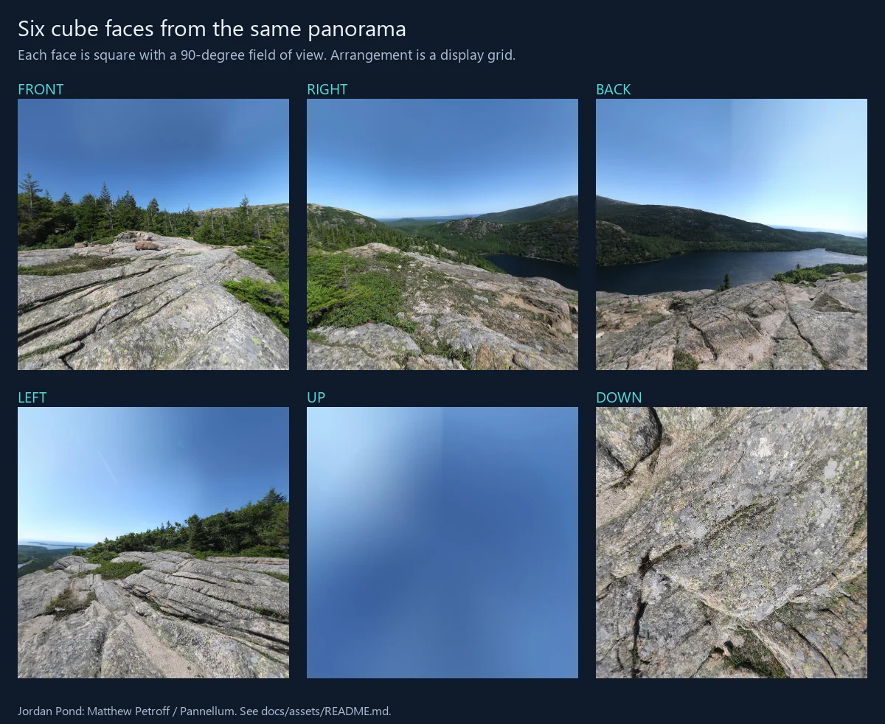

# Ray360

Perspective views, cubemap crosses, and seam-aware annotation mapping for **stitched 360 images and video frames**.

[](https://pypi.org/project/ray360/)
[](https://pypi.org/project/ray360/)
[](https://github.com/aasmanbashyal/ray360/actions/workflows/tests.yml)
[](https://github.com/aasmanbashyal/ray360/blob/main/LICENSE)

Extract perspective views for a model and map its predictions back to the sphere.
Convert between equirectangular panoramas and cubemap crosses while carrying box
annotations across cube faces and the panorama seam. View transforms retain the
geometry through crop, resize, and letterbox operations.

Python 3.11+ · NumPy core · Optional Pillow image helpers · MIT license

[Install](#install) · [Quick start](#quick-start) · [API reference](https://github.com/aasmanbashyal/ray360/blob/main/docs/api.md)
· [Examples](#examples) · [Contribute](#contributing-and-support)



Actual Ray360 output from *Jordan Pond* by Matthew Petroff / Pannellum.
[Image credits and reproduction](https://github.com/aasmanbashyal/ray360/blob/main/docs/assets/README.md).

## Where Ray360 fits

```text
Stitched panorama or decoded video frame
              │
              ▼
    Ray360: extract views → crop / resize / letterbox
              │
              ▼
    Your application: run a model and collect predictions
              │
              ▼
    Ray360: map points and boxes back to the panorama
```

| Task | Ray360 provides |
| --- | --- |
| Prepare model inputs | Perspective views, full-sphere view coverage, and preprocessing |
| Convert projections | Equirectangular images ↔ named cube faces and horizontal crosses |
| Map predictions | View-space points and boxes, plus polygon outlines from cubemap cross boxes |
| Render mapped objects | Seam-split polygons, approximate rectangles, and pixel membership masks |
| Process repeated frames | Reusable coordinate maps with a bounded cache |
| Save geometry | Versioned JSON-compatible transforms, regions, and provenance |

Applications supply already-stitched pixels and own inference, video decoding,
timestamps, tracking, and export formats. Ray360 does not stitch raw camera feeds
or bundle a model. See the [scope](https://github.com/aasmanbashyal/ray360/blob/main/docs/scope.md).

## Install

Add Ray360 to a uv project:

```bash
uv add ray360
# Include image loading, saving, and overlays:
uv add "ray360[image]"
```

Or install with pip:

```bash
pip install ray360
pip install "ray360[image]"  # Optional image helpers
```

The core depends only on NumPy. Model and decoder dependencies are installed
separately by the application. See [PyPI](https://pypi.org/project/ray360/) and the
[release history](https://github.com/aasmanbashyal/ray360/releases).

## Quick start

This example runs with the NumPy-only installation. Replace the synthetic array
and example prediction with your stitched image and model output.

```python
import numpy as np
from ray360 import Box2D, Panorama, Perspective

pixels = np.zeros((360, 720, 3), dtype=np.uint8)
panorama = Panorama(pixels, source_id="capture")

# yaw=180 looks across the panorama seam.
view = panorama.view(Perspective(320, 180, yaw=180, hfov=90))
model_view = view.letterbox(320, 320)

# Run your model on model_view.image. Boxes use its pixel coordinates.
predictions = [Box2D(90, 100, 230, 220, label="person", score=0.9)]
region = model_view.map_boxes(predictions)[0]

polygons = region.polygons(panorama.projection)
mask = region.rasterize(panorama.projection)
print(model_view.image.shape)  # (320, 320, 3)
print(len(polygons))  # 2 pieces at the seam, still one object
print(mask.shape)  # (360, 720)
```

`region.box` retains the label, score, tracking ID, and custom attributes. Crop and
resize operations also preserve the transform. Map individual points with
`model_view.transform.to_panorama(points)` and use its returned validity mask.



The box above is a geometry demonstration, not a model detection. Its two
panorama pieces belong to the same spherical region.

### Convert cube faces

```python
import numpy as np
from ray360 import Equirectangular, Panorama, from_cubemap, to_cubemap, to_cubemap_cross

panorama = Panorama(np.zeros((360, 720, 3), dtype=np.uint8))
faces = to_cubemap(panorama, size=256)
restored = from_cubemap(faces, Equirectangular(720, 360))
cross = to_cubemap_cross(panorama, size=256)

print(sorted(faces))  # ['back', 'down', 'front', 'left', 'right', 'up']
print(restored.shape)  # (360, 720, 3)
print(cross.shape)     # (768, 1024, 3)
```

Faces are square with a 90-degree field of view. Bilinear reconstruction samples
neighboring faces at their boundaries. For model predictions on a cube face, use
`panorama.view(cube_projections(size)["front"])` to retain its view transform.
See [face orientation and conversion](https://github.com/aasmanbashyal/ray360/blob/main/docs/api.md#cubemap-conversion).

`to_cubemap_cross()` puts all six faces in one image, with top and bottom above
and below front and left, front, right, and back across the middle. To save it
with the `image` extra, use `ray360.image.write_image("cubemap.png", cross)`.



### Reconstruct a cubemap cross with boxes

Use the `(x1, y1, x2, y2)` coordinates measured on the full-size cross image.
This example uses the Back face of a cross with 1024 pixels per face.

```python
import numpy as np
from PIL import Image

from ray360 import Equirectangular, from_cubemap_cross
from ray360.image import write_image

with Image.open("cubemap.png") as source:
    cross = np.asarray(source.convert("RGB"))

image, [outline] = from_cubemap_cross(
    cross,
    Equirectangular(2048, 1024),
    boxes=[(3350, 1410, 3820, 1735)],
    draw_boxes=True,
)
write_image("panorama-with-box.png", image)
```

Each input box has one group of polygons, even when it crosses multiple faces or
the panorama seam. Set `draw_boxes=True` with the `image` extra to draw the
outlines. The default returns clean pixels and the same polygon groups.

### Read an image and draw mapped predictions

With the `image` extra installed and a stitched image named `stitched.jpg`:

```python
from ray360 import Box2D, Perspective
from ray360.image import overlay, read_panorama, write_image

panorama = read_panorama("stitched.jpg")
view = panorama.view(Perspective(640, 360, yaw=180))
regions = view.map_boxes([Box2D(240, 100, 400, 260, label="example")])
result = overlay(panorama.image, regions, projection=panorama.projection)
write_image("mapped.png", result)
```

Loading returns uint8 RGB without rotating the stored pixels. Saving refuses to
overwrite an existing file unless `overwrite=True` is supplied.

## Video and repeated views

Decode each video frame to a panorama array in your application. Reuse a
`MapCache` and the same target projections across frames with matching dimensions
and orientation. `panorama.views(targets, cache=cache)` yields views one at a time.
The [PyAV example](https://github.com/aasmanbashyal/ray360/blob/main/examples/video_frames.py)
shows the decoder boundary and timestamp handling.

`coverage_views()` defaults to 24 views covering the sphere. Select view size,
field of view, and overlap using your application's accuracy and latency needs.
The default shared map cache is capped at 128 MiB; that limit covers cached maps,
not source images, output arrays, or temporary allocations.

## Behavior to know

- Inputs are HW or HWC NumPy arrays. Arrays remain caller-owned, and sampling
  preserves their dtype. Use nearest sampling for labels, booleans, and 64-bit integers.
- Predictions wholly inside preprocessing padding are discarded; partial boxes
  are clipped. Ignore point coordinates whose validity mask is false.
- A spherical region remains one object even when it renders as two seam pieces.
  Its exported rectangles are approximate. Use `rasterize()` for membership at pixel centers.
- Projection conversion resamples pixels and may lose detail. Geometry tests do
  not establish detector accuracy or camera calibration.
- `ray360.experimental` contains sampled spherical IoU and NMS. Small objects may
  receive zero sampled overlap. These functions are outside the supported root API.

Ray360 is an early `0.x` library. API changes will be described in the
[changelog](https://github.com/aasmanbashyal/ray360/blob/main/docs/changelog.md).

## Examples

| Example | What it demonstrates | Dependencies |
| --- | --- | --- |
| [basic.py](https://github.com/aasmanbashyal/ray360/blob/main/examples/basic.py) | A synthetic panorama, letterboxing, and a seam-crossing prediction | NumPy; Pillow for optional output |
| [detect.py](https://github.com/aasmanbashyal/ray360/blob/main/examples/detect.py) | Application-owned YOLO inference and prediction mapping | Image extra and Ultralytics |
| [video_frames.py](https://github.com/aasmanbashyal/ray360/blob/main/examples/video_frames.py) | Decoding stitched video frames and retaining timestamps | Image extra and PyAV |
| [readme_gallery.py](https://github.com/aasmanbashyal/ray360/blob/main/examples/readme_gallery.py) | Reproducing the figures on this page | Image extra and the public panorama fixture |

The [validation guide](https://github.com/aasmanbashyal/ray360/blob/main/docs/validation.md)
includes setup commands and recorded real-image, cubemap, model, and video checks.
The normal test suite never downloads media or weights. Integration fixtures are
opt-in and checksum-verified.

## Documentation

- [API reference](https://github.com/aasmanbashyal/ray360/blob/main/docs/api.md): coordinates, shapes, transforms, persistence, and rendering.
- [Scope](https://github.com/aasmanbashyal/ray360/blob/main/docs/scope.md): supported use cases and criteria for new features.
- [Validation](https://github.com/aasmanbashyal/ray360/blob/main/docs/validation.md) and [benchmarks](https://github.com/aasmanbashyal/ray360/blob/main/docs/benchmarks.md): what was tested and measured.
- [Release guide](https://github.com/aasmanbashyal/ray360/blob/main/docs/releasing.md): maintainer publishing workflow.

## Contributing and support

Start a [discussion](https://github.com/aasmanbashyal/ray360/discussions) for usage
questions, integration ideas, or feedback from a consuming project. Use the
[issue forms](https://github.com/aasmanbashyal/ray360/issues/new/choose) for
reproducible bugs and concrete feature proposals.

The [contribution guide](https://github.com/aasmanbashyal/ray360/blob/main/CONTRIBUTING.md)
covers local setup, tests, branch names, and the pull request process. Useful
contributions include small geometry reproductions, clearer examples, and
measurements on stitched media. Discuss new backends or annotation types before
starting a large change.

Report vulnerabilities through the
[security policy](https://github.com/aasmanbashyal/ray360/blob/main/SECURITY.md).
Ray360 is maintained by [Aasman Bashyal](https://github.com/aasmanbashyal) and
distributed under the [MIT license](https://github.com/aasmanbashyal/ray360/blob/main/LICENSE).
