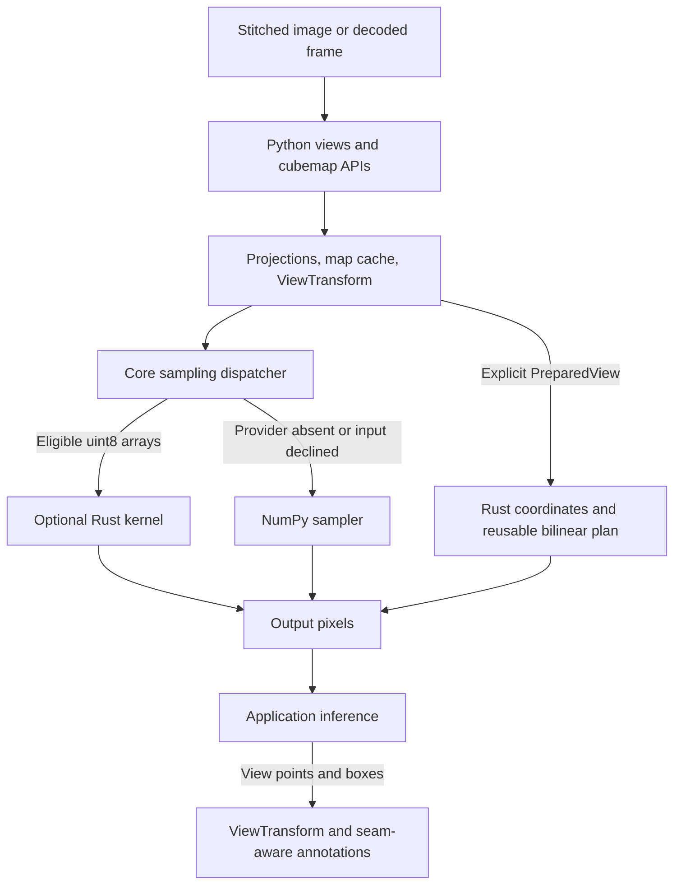

# Ray360 architecture

The Python core owns projection geometry, transform provenance, label dtypes,
annotation mapping, and the NumPy reference sampler. On the first sampling call
it looks for the optional `try_sample_v1` provider. The provider accepts NumPy
arrays and returns a sampled array or `None` when the dtype, layout, coordinates,
or mask are outside its contract. An `ImportError` during discovery selects
NumPy for the process, including when the provider is missing or older.
Other initialization exceptions and errors from a loaded provider propagate.
Changing the provider contract requires a new entry-point name.

The Rust provider can load and sample without importing Ray360. The optional
`PreparedView` wrapper uses a `ViewTransform` to generate a reusable bilinear
plan. It samples the source panorama once per frame and returns a `View` with
the retained transform. With the automatic engine it uses NumPy for unsupported
array dtypes, layouts, and source dimensions. A fused view can produce different
pixels from eager crop, resize, and letterbox because each eager step resamples.

The core and Rust distributions each require NumPy. The core's `image` extra
installs Pillow for file I/O and overlays. The Rust distribution's `ray360`
extra installs the core for `PreparedView` and for NumPy fallback from direct
native calls. Applications install their own model and decoder dependencies.
The publishing workflow builds the core wheel and source distribution. The
native wheel is built separately. The core source archive keeps the code,
tests, and text documentation. The README gallery images are hosted on GitHub.

The [validation guide](validation.md) describes smoke tests for installing each
distribution by itself and checking pixel parity when both are installed.
